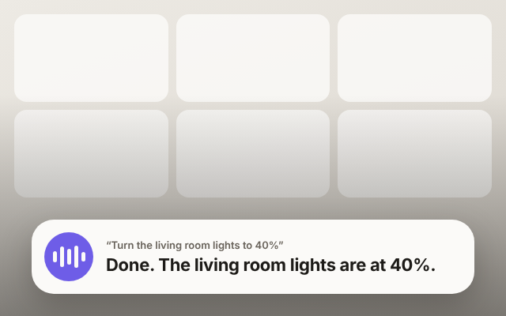

# Hearth voice skin for Kiosk Satellite

NETb Home's **Hearth** look for Kiosk Satellite's voice assistant. When you talk to a kiosk, the turn appears as one warm card near the bottom of the screen, the way it does in NETb Home:

- a violet orb whose bars move with your voice, with soft rings breathing out while it listens;
- a small label: **Listening**, **Thinking** (an amber ring turns round the orb) or **Announcement**;
- what you said in large type while you speak; once there's an answer, it moves above in grey, in quotes, and the answer takes the big line;
- the last thing the assistant did (a light, a timer) in amber underneath.

**Full screen**, the dashboard stays in view and darkens towards the card. **Docked**, the same card is smaller and the dashboard stays usable. Every touch passes through, so a double tap still dismisses the turn.

## Use it

1. In Kiosk Satellite, open **Settings › Plugin Manager › Add plugin** and enter this repository: `https://github.com/SamB-GB/netb-kiosk-voice-skin`.
2. Review it, choose **Trust and install**, then turn the plugin on.
3. In **Voice Satellite › Appearance**, set **Assistant 1 skin** (and **Assistant 2 skin** if you use a second wake word) to **Hearth**. Press **Preview** to see it.

It follows the other Appearance settings, as the built-in skins do:

| Setting | What Hearth does |
| --- | --- |
| Theme | Auto follows Kiosk Satellite's light or dark; Light and Dark force them |
| Background | How dark the full screen backdrop gets at the bottom (Skin default: half) |
| Text size | Scales every line |
| Reactive activity bar | Off: the bars stop moving with your voice |
| Overlay mode | Full screen or Docked |

If the plugin is turned off or stops, Kiosk Satellite draws its own skin until it runs again; your pick stays saved.

Needs Kiosk Satellite 2026.10.45 or newer.

## Build and release

This repository is the [Kiosk Satellite Plugins](https://github.com/jxlarrea/kiosk-satellite-plugins) template with the Hello World example taken out and the skin in `src/uk/netb/kiosk/hearth/`.

- Test locally (needs JDK 17+ and an Android SDK with a platform and build-tools): `python3 tools/test.py`, then `python3 tools/build.py`. The ZIP in `dist/` can be installed with **Plugin Manager › Developer Tools › Install from ZIP** for testing.
- Release: commit, then publish a GitHub release with a tag such as `v1.0.0`. The workflow in `.github/workflows/build.yml` builds, tests and attaches the plugin ZIP, its checksum and the manifest. Kiosk Satellite installs only releases built by that workflow.

## Licence

Apache-2.0. The SDK interfaces in `sdk/` and the tools in `tools/` are from the Kiosk Satellite Plugins SDK (Apache-2.0); the skin started from its Hello World voice skin.
